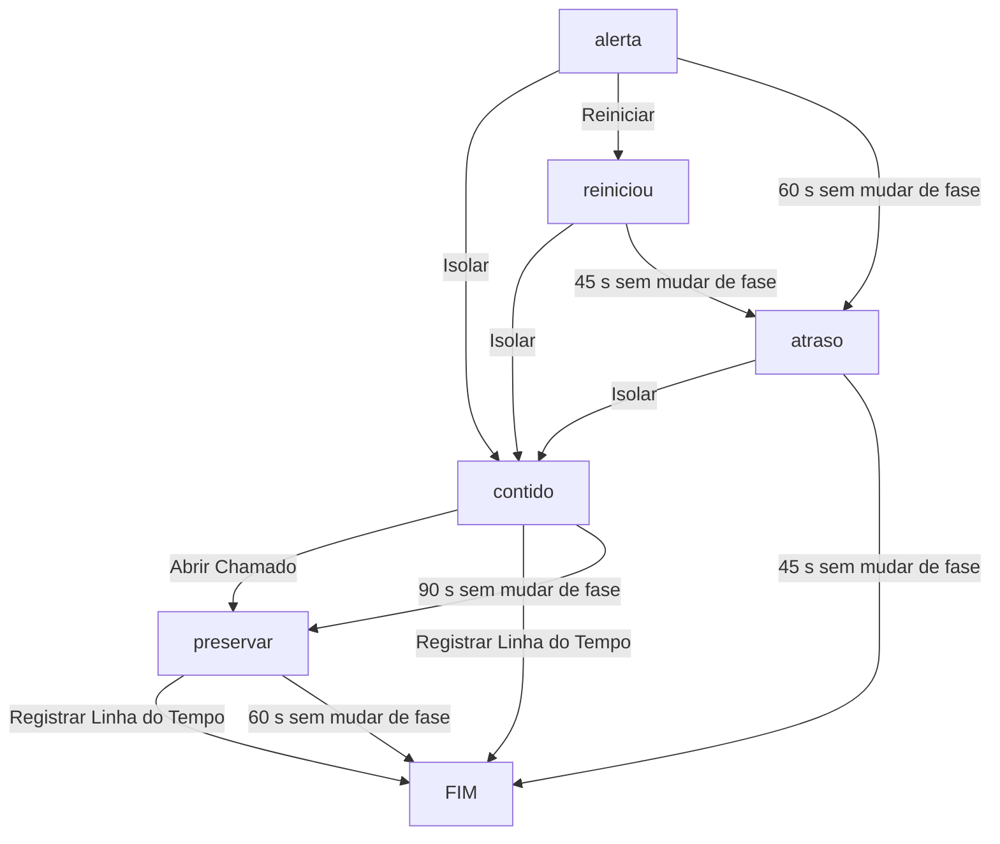

# TableTop "Máquina Contaminada" — Documentação

Exercício de resposta a incidentes em formato web. O participante usa uma área de trabalho simulada (estilo Windows) e reage a um alerta de antivírus clicando em ícones. O servidor controla fases, tempo, pontuação, finais e log.

Versão documentada: **Opção A (web)**, com cenário em fases e ações por ícones.

---

## 1. Visão geral

|Item|Descrição|
|---|---|
|Objetivo|Treinar a resposta a uma máquina contaminada: conter, comunicar, preservar evidências|
|Formato|Participante em um navegador, facilitador em outra aba ou computador|
|Interação|Somente ícones (sem perguntas ou digitação, exceto o nome inicial)|
|Pontuação|Automática, no servidor, conforme a ação **e a fase** em que ela é executada|
|Finais|4 finais alternativos, calculados por flags e pontos|
|Isolamento|**Simulado** (nada é desconectado de verdade)|
|Alerta do BitDefender|**Ilustrativo**, desenhado dentro da página|

---

## 2. Arquitetura

### 2.1 Componentes

```
┌──────────────────────────────┐        HTTP (JSON)        ┌─────────────────────────────────┐
│  NAVEGADOR DO PARTICIPANTE   │ ◄───────────────────────► │  SERVIDOR (Flask, seu PC)       │
│  participante.html           │   polling a cada 2 s      │  app.py                         │
│  - área de trabalho          │                           │  - lê cenario.json a cada req.  │
│  - ícones, janelas, efeitos  │                           │  - guarda estado em memória     │
│  - sons e animações          │                           │  - calcula pontos, fases, final │
└──────────────────────────────┘                           │  - grava dados/log_decisoes.csv │
                                                           └────────────▲────────────────────┘
┌──────────────────────────────┐        HTTP (JSON)                     │
│  NAVEGADOR DO FACILITADOR    │ ◄──────────────────────────────────────┘
│  facilitador.html            │   polling a cada 2 s
│  - placar e flags            │
│  - Encerrar / Resetar / CSV  │
└──────────────────────────────┘
```

**Princípio central:** o navegador só desenha e envia cliques. **Toda a regra** (tempo, fases, pontos, finais) fica no servidor, então recarregar a página ou mexer no relógio do navegador não burla nada.

### 2.2 Estrutura de arquivos

```
tabletop/
├── app.py                      # servidor Flask: regras, API, log
├── cenario.json                # conteúdo do exercício (fases, ações, finais)
├── dados/
│   └── log_decisoes.csv        # gerado automaticamente
└── templates/
    ├── participante.html       # área de trabalho simulada
    └── facilitador.html        # painel de acompanhamento
```

### 2.3 Tecnologias

- **Servidor:** Python 3 + Flask (única dependência).
- **Cliente:** HTML, CSS e JavaScript puros, sem bibliotecas e sem imagens externas (ícones são emojis).
- **Sons:** gerados pelo navegador (Web Audio API), sem arquivos de áudio.
- **Armazenamento:** estado dos participantes **em memória** (perde-se ao reiniciar o servidor); log em CSV em disco.
- **Rede:** o servidor escuta em `0.0.0.0:5000`.

### 2.4 Endpoints da API

|Método|Rota|Função|
|---|---|---|
|GET|`/`|Página do participante|
|GET|`/facilitador`|Painel do facilitador|
|POST|`/api/entrar`|Cria (ou recupera) o participante pelo nome|
|POST|`/api/iniciar`|Dispara os cronômetros (chamado ao fim da introdução)|
|GET|`/api/estado/<pid>`|Estado atual; **também avalia estouros de tempo**|
|POST|`/api/executar`|Executa uma ação (ícone)|
|GET|`/api/painel`|Dados do placar do facilitador|
|POST|`/api/encerrar`|Finaliza o exercício de todos que estão jogando|
|POST|`/api/resetar`|Apaga todos os participantes da memória|
|GET|`/api/csv`|Baixa o log de decisões|

### 2.5 Estado guardado por participante (servidor)

|Campo|Significado|
|---|---|
|`nome`|Identificador do participante (o nome digitado)|
|`fase`|Fase atual do incidente|
|`pontos`|Pontuação acumulada|
|`flags`|Marcas do que o participante fez (ex.: `isolou`)|
|`usadas`|Ações já executadas (cada uma só vale uma vez)|
|`historico`|Lista de decisões com pontos, tempo e feedback|
|`inicio_total`|Instante em que o relógio total começou|
|`inicio_fase`|Instante em que a fase atual começou|
|`finalizado` / `final`|Se terminou e qual final recebeu|

---

## 3. Fluxo do participante

### 3.1 Tela inicial

O participante digita o nome e clica em **Começar**. O clique também libera o áudio do navegador.

### 3.2 Introdução (cerca de 18 segundos, **fora do cronômetro**)

|Tempo aprox.|O que acontece|
|---|---|
|0 s|Área de trabalho aparece, calma, com a grade de ícones **ainda oculta**|
|6 s|Janela do Bloco de Notas abre sozinha|
|6–10 s|Texto é "digitado" letra por letra: _"Este arquivo foi criado automaticamente. Ninguém digitou nada aqui. [EXERCÍCIO SIMULADO]"_|
|~11 s|Alerta do BitDefender surge, borda vermelha pulsa, 4 bipes de alarme|
|~14 s|Faixa narrada: **"O que deve fazer?"** (aparece uma única vez)|
|~18 s|Faixa, Bloco de Notas, alerta e borda somem; **ícones aparecem**|
|~18 s|Cliente chama `/api/iniciar`: **os cronômetros começam aqui**|

### 3.3 Jogo

Só ícones. Fluxo de interação:

1. Clique em um ícone: a grade desliza para a esquerda (3 colunas) e a janela **Detalhes da ação** entra pela direita, com nome e descrição do que a ação faz (nunca diz se é certa ou errada).
2. **Cancelar** fecha a janela e devolve a grade ao centro, sem custo.
3. **Executar** envia a ação ao servidor. O ícone fica esmaecido e bloqueado (cada ação vale uma vez).
4. Um aviso (toast) mostra a consequência da ação.
5. Se a ação muda a fase, um aviso com o novo evento também aparece (ver seção 14).

### 3.4 Fim

A tela final mostra o final alcançado, a pontuação e o **Debriefing**: cada decisão, a fase, o tempo, os pontos e o feedback explicativo.

---

## 4. Interface do participante

### 4.1 Elementos

|Elemento|Função|
|---|---|
|Grade de ícones|Até 10 ações, em **ordem embaralhada** a cada partida|
|Janela de detalhes|Explica a ação e oferece Executar/Cancelar|
|Bloco de Notas|Aparece na introdução e após reinício|
|Alerta BitDefender|Janela vermelha ilustrativa no canto inferior direito|
|Toast (canto inferior esquerdo)|Mostra consequências e novos eventos por 7 s|
|Barra de tarefas|Ícone BitDefender, rede, barra de risco, pontos, tempo total, mudo, relógio|
|Tela preta|Simula reinício|
|Pop-ups de erro|Simulam o caos na rede|
|Faixa narrada|"O que deve fazer?"|

### 4.2 Indicadores da barra de tarefas

- **BitDefender:** pisca em vermelho enquanto a máquina **não** foi isolada.
- **Rede:** mostra "🌐 Rede" e muda para "🚫 Sem rede" após isolar.
- **Risco:** barra verde (até 33), amarela (34–66), vermelha (acima de 66).
- **Pontos:** soma atual.
- **Tempo:** contagem regressiva do tempo total (sincronizada com o servidor a cada 2 s).
- **Som:** botão para mudo.

### 4.3 Sons

|Som|Quando|
|---|---|
|4 bipes agudos|Alerta do BitDefender (introdução e após reinício)|
|Bipe médio|Abertura do Bloco de Notas, novos avisos (toast)|
|Bipes graves|Cada pop-up de erro do caos|

---

## 5. Motor do cenário (`cenario.json`)

O servidor **relê o arquivo a cada requisição**, então textos, pontos e tempos podem ser ajustados com o servidor rodando.

```
{
  "titulo", "tempo_total", "inicio",
  "fases":  { <id>: { evento, limite, efeito?, se_demorar? } },
  "acoes":  { <id>: { nome, icone, descricao, fases: { <fase>: resultado }, padrao: resultado } },
  "finais": [ { titulo, tipo, texto, condicao } ]
}
```

### 5.1 Fase

|Campo|Significado|
|---|---|
|`evento`|Texto mostrado ao entrar na fase|
|`limite`|Segundos que o participante tem nessa fase|
|`efeito`|Efeito visual ao entrar (hoje só existe `"caos"`)|
|`se_demorar`|O que acontece se o `limite` estourar: `pontos`, `flags`, `proxima`, `feedback`|

### 5.2 Ação

- `fases`: resultado específico para cada fase em que a ação pontua de forma diferente.
- `padrao`: resultado usado quando a fase atual não está listada em `fases`.
- **Resultado:** `pontos`, `flags`, `proxima` (fase seguinte ou `"FIM"`), `efeito` (`"reboot"`), `consequencia` (aviso na tela), `feedback` (texto do debriefing).

### 5.3 Final

`condicao` aceita `requer` (flags obrigatórias), `proibe` (flags proibidas) e `min_pontos`. Os finais são avaliados **de cima para baixo** e vale o **primeiro** que bater. O último, com `condicao` vazia, funciona como final padrão.

---

## 6. Fases e transições



Além disso, **Formatar Máquina** leva a FIM em qualquer fase, e o **tempo total** ou **Encerrar todos** finalizam em qualquer fase.

### 6.1 Tabela de fases

|Fase|Evento exibido|Limite|Se estourar|Pontos|Flag|Vai para|Efeito|
|---|---|---|---|---|---|---|---|
|`alerta`|BitDefender detectou comportamento suspeito em notepad.exe|60 s|Sem ação a tempo|-15|`ignorou`|`atraso`|—|
|`reiniciou`|A máquina reiniciou, o Bloco de Notas abriu de novo e o BitDefender alertou outra vez|45 s|Sem ação a tempo|-15|`ignorou`|`atraso`|—|
|`atraso`|Colegas relatam arquivos estranhos na pasta compartilhada|45 s|Sem ação a tempo|-10|`ignorou`|`FIM`|**caos** (6 pop-ups)|
|`contido`|Máquina isolada; a TI aguarda seu relato|90 s|Demora no relato|-2|—|`preservar`|—|
|`preservar`|O SOC pede que você preserve a situação da máquina|60 s|Sem registro organizado|-3|—|`FIM`|—|

### 6.2 Regra importante do cronômetro de fase

O `inicio_fase` **só é reiniciado quando a fase muda**. Executar ações que não mudam de fase (Gestor, Antivírus, Gerenciador de Tarefas, etc.) **não dá mais tempo**: o relógio da fase continua correndo.

---

## 7. Ações (ícones)

|Ícone|Ação|O que a descrição diz|
|---|---|---|
|🌐|Isolar da Rede|Desconecta a máquina da rede, mantendo-a ligada e com memória preservada|
|🔄|Reiniciar|Desliga e liga o computador, encerrando todos os programas|
|💬|Chat do Gestor|Avisa o gestor sobre o que está acontecendo|
|🎫|Abrir Chamado (SOC)|Registra um incidente com horário, link clicado e alerta exibido|
|🛡️|Varredura BitDefender|Executa uma varredura completa|
|🧹|Limpar Histórico|Apaga histórico, cookies e temporários do navegador|
|🔌|Desligar da Tomada|Interrompe a energia imediatamente|
|💽|Formatar Máquina|Apaga o disco e reinstala o sistema|
|📝|Registrar Linha do Tempo|Anota horários, telas e ações, mantendo a máquina como está|
|📊|Gerenciador de Tarefas|Mostra processos e uso de recursos|

### 7.1 Matriz de pontos por fase

Valores **sem** o bônus de tempo. "(p)" indica o resultado `padrao`.

|Ação|`alerta`|`reiniciou`|`atraso`|`contido`|`preservar`|Flag|Muda de fase?|
|---|---|---|---|---|---|---|---|
|Isolar|**+10**|+5|+3|-2 (p)*|-2 (p)*|`isolou`|Sim, para `contido`|
|Reiniciar|**-10**|-8 (p)|-8 (p)|-8 (p)|-8 (p)|`perdeu_evidencia`|Só em `alerta` (vai para `reiniciou`)|
|Chat do Gestor|+4 (p)|+4 (p)|+4 (p)|+4 (p)|+4 (p)|`comunicou`|Não|
|Abrir Chamado|+5|+5|+4 (p)|**+10**|+4 (p)|`comunicou_soc`|Só em `contido` (vai para `preservar`)|
|Varredura|+2 (p)|+2 (p)|+2 (p)|+2 (p)|+2 (p)|—|Não|
|Limpar Histórico|-10 (p)|-10 (p)|-10 (p)|-10 (p)|-10 (p)|`apagou_evidencia`|Não|
|Desligar|-3 (p)|-3 (p)|-3 (p)|-3 (p)|-3 (p)|`perdeu_evidencia`|Não|
|Formatar|-10 (p)|-10 (p)|-10 (p)|-10 (p)|-10 (p)|`apagou_evidencia`|**Sempre: FIM**|
|Linha do Tempo|+2 (p)|+2 (p)|+2 (p)|**+10**|**+10**|`preservou`|Em `contido` e `preservar`: **FIM**|
|Gerenciador|0 (p)|0 (p)|0 (p)|0 (p)|0 (p)|—|Não|

* Na prática, estas células não são alcançáveis: quem chega a `contido` ou `preservar` já usou o Isolar, e cada ação só vale uma vez.

### 7.2 Efeitos visuais das ações

- **Reiniciar** e **Desligar** (`efeito: reboot`): tela preta por 3 s; o Bloco de Notas volta com "Olá novamente.", a borda vermelha pisca e o alarme toca por cerca de 3,5 s. Reiniciar em `alerta` também leva à fase `reiniciou`; Desligar **não** muda de fase.
- **Isolar:** o ícone de rede vira "🚫 Sem rede" e o BitDefender na barra para de piscar.
- **Formatar:** encerra imediatamente o exercício.

---

## 8. Pontuação

### 8.1 Composição

```
pontos da decisão = pontos da ação (conforme a fase) + bônus de tempo
total = soma das decisões e das penalidades automáticas
```

### 8.2 Bônus de tempo

**+3 pontos** se **as duas** condições forem verdadeiras:

1. a ação tem pontuação positiva;
2. foi executada em até **50% do limite** da fase (contado desde o início da fase).

|Fase|Bônus se executar em até|
|---|---|
|`alerta`|30 s|
|`reiniciou`|22,5 s|
|`atraso`|22,5 s|
|`contido`|45 s|
|`preservar`|30 s|

Penalidades automáticas (`se_demorar` e tempo total) **não** recebem bônus.

### 8.3 Penalidades automáticas

- Estouro de fase: valores da tabela 6.1.
- **Tempo total esgotado:** -5 pontos, flag `tempo_esgotado`, exercício encerrado.

### 8.4 Flags

|Flag|Origem|Efeito|
|---|---|---|
|`isolou`|Isolar|Ícone de rede, BitDefender para de piscar, risco cresce mais devagar, exigida nos finais exemplar e parcial|
|`comunicou_soc`|Abrir Chamado|Exigida no final exemplar|
|`preservou`|Linha do Tempo (em `contido`/`preservar`)|Exigida no final exemplar|
|`comunicou`|Chat do Gestor|Apenas registrada (não influencia final)|
|`ignorou`|Estouro de fase em `alerta`, `reiniciou` ou `atraso`|**Final "Vazamento de dados"**; +15 de risco|
|`perdeu_evidencia`|Reiniciar, Desligar|Impede final exemplar; +15 de risco|
|`apagou_evidencia`|Limpar Histórico, Formatar|Impede final exemplar; +15 de risco|
|`tempo_esgotado`|Tempo total|Impede final exemplar; +15 de risco|

### 8.5 Barra de risco

```
risco = 10 + (tempo decorrido / tempo_total × 50) × (0,4 se isolou, senão 1)
           + 15 × (quantidade de flags ruins)
```

Limitado a 100. As flags ruins são `perdeu_evidencia`, `apagou_evidencia`, `ignorou` e `tempo_esgotado`. É apenas visual: **não altera pontos nem finais**.

---

## 9. Finais

Avaliados nesta ordem (vale o primeiro que bater):

|#|Final|Condição|Tipo|
|---|---|---|---|
|1|**Vazamento de dados**|Tem a flag `ignorou`|ruim|
|2|**Contenção exemplar**|Tem `isolou`, `comunicou_soc` e `preservou`; **não** tem `perdeu_evidencia`, `apagou_evidencia`, `ignorou`, `tempo_esgotado`; pontos ≥ 30|ótimo|
|3|**Contenção parcial**|Tem `isolou`; não tem `ignorou`; pontos ≥ 5|médio|
|4|**Propagação na rede**|Qualquer outro caso|ruim|

### 9.1 Consequências práticas

- **Basta uma vez cair em `ignorou` para o final ser "Vazamento de dados"**, mesmo que depois o participante isole, abra chamado e preserve tudo. A reação tardia melhora os pontos, mas não o final.
- Para o final exemplar, é preciso **isolar, abrir o chamado e registrar a linha do tempo**, sem nenhuma flag ruim, somando 30 pontos ou mais. O caminho mínimo (+10, +10, +10) já atinge 30; os bônus de tempo podem levar a até 39.
- Cair em "Propagação na rede" é possível sem ter ignorado, por exemplo ao **formatar sem isolar**, ou ao isolar mas somar menos de 5 pontos por decisões ruins.

---

## 10. O que acontece quando o participante não reage

Este é o comportamento que você observou: os avisos de arquivos compartilhados são a **escalada planejada** da fase `atraso`.

### 10.1 Linha do tempo de um participante parado

Contada a partir do fim da introdução (a verificação ocorre no polling, então pode haver até ~2 s de atraso):

|Tempo|O que acontece|Pontos|Flags|
|---|---|---|---|
|0 s|Ícones aparecem, fase `alerta`, BitDefender pisca|0|—|
|60 s|Sem ação a tempo: vai para `atraso`. Aviso _"Colegas relatam arquivos estranhos na pasta compartilhada."_ **e 6 pop-ups de "Erro do sistema"** (um a cada 0,7 s, posições aleatórias, cada um some após 9 s, com bipes graves)|-15|`ignorou`|
|105 s|Sem ação a tempo de novo: exercício encerrado|-10 (total -25)|`ignorou`|
|105 s|Final **"Vazamento de dados"**|||

### 10.2 Outras formas de ficar parado

|Situação|Resultado|
|---|---|
|Parado em `reiniciou`|Após 45 s: -15, `ignorou`, vai para `atraso` (caos); após mais 45 s: -10 e FIM|
|Isolou e ficou parado em `contido`|Após 90 s: -2, vai para `preservar`; após mais 60 s: -3 e FIM. Final provável: **Contenção parcial** (10 - 2 - 3 = 5 pontos)|
|Parado em `preservar`|Após 60 s: -3 e FIM|
|Fechou a aba e voltou depois|O tempo continua contando no servidor, mas só é avaliado no próximo polling (ver seção 14)|
|Passaram 420 s do início|-5, `tempo_esgotado`, FIM (rede de segurança; na prática as fases encerram antes)|

### 10.3 Detalhes do efeito "caos"

- Dispara **apenas quando o navegador percebe a troca para `atraso` ao vivo**. Se a página for recarregada depois, os pop-ups não reaparecem.
- Está definido por `"efeito": "caos"` na fase; para repetir o efeito em outra fase, basta colocar o mesmo campo nela.

---

## 11. Catálogo de tudo o que pode acontecer

### 11.1 Eventos automáticos (sem clique do participante)

1. Introdução com Bloco de Notas, alerta e narração.
2. Mudança de fase por estouro de tempo (tabela 6.1).
3. Caos de pop-ups ao entrar em `atraso`.
4. Encerramento por estouro do tempo total (420 s).
5. Atualização de risco, pontos e tempo a cada 2 s.
6. Encerramento por **Encerrar todos** no painel.

### 11.2 Eventos por ação do participante

1. Abrir/cancelar a janela de detalhes (sem custo).
2. Executar ação: pontuação, flags, possível troca de fase, aviso de consequência.
3. Reinício simulado (tela preta e retorno do Bloco de Notas).
4. Isolamento simulado (ícone de rede e BitDefender mudam).
5. Fim imediato por **Formatar** ou por **Linha do Tempo** em `contido`/`preservar`.
6. Tentativa de repetir ação: o ícone está bloqueado; se a requisição chegar ao servidor, é recusada (erro 400).

### 11.3 Eventos do facilitador

1. Acompanhar placar, fase, ações, flags e final de cada participante.
2. **Encerrar todos:** finaliza e calcula o final de quem está jogando.
3. **Resetar:** apaga os participantes da memória.
4. **Baixar CSV:** exporta o log.

### 11.4 Situações de borda

|Situação|O que acontece|
|---|---|
|Recarregar a página durante o jogo|Volta direto à área de trabalho, sem introdução, no estado atual|
|Recarregar durante a introdução|Volta à tela inicial; o cronômetro ainda não tinha começado|
|Dois participantes com o mesmo nome|**Compartilham o mesmo estado** (o nome é o identificador)|
|Participante já finalizado recarrega|Reabre direto na tela final|
|Servidor reiniciado|Estado em memória perdido; ao recarregar, o participante volta à tela inicial|
|Facilitador clica em Resetar|Participantes somem; quem estava jogando é mandado à tela inicial no próximo reload|
|Servidor fora do ar durante o jogo|O navegador falha em silêncio e mantém a última tela|
|Ação enviada após o fim|Recusada pelo servidor|

---

## 12. Painel do facilitador

Acessível em `/facilitador`, atualiza a cada 2 s.

|Coluna|Conteúdo|
|---|---|
|Participante|Nome|
|Fase|Fase atual, "não iniciou" ou "concluído"|
|Ações|Quantidade de ícones executados|
|Pontos|Pontuação (ordenado do maior para o menor)|
|Flags|Marcas do que fez|
|Final|Título do final, quando existir|

Botões: **Encerrar todos**, **Resetar**, **Baixar CSV**.

---

## 13. Dados e log

Arquivo `dados/log_decisoes.csv` (separador `;`, codificação compatível com Excel).

|Coluna|Conteúdo|
|---|---|
|`data_hora`|Momento do registro|
|`participante`|Nome|
|`fase`|Fase em que ocorreu|
|`acao`|Nome da ação, ou "Sem ação a tempo" / "Tempo total esgotado"|
|`pontos_acao`|Pontos da ação (sem o bônus)|
|`bonus_tempo`|0 ou 3|
|`tempo_s`|Segundos desde o início da fase|
|`total`|Pontuação acumulada após o registro|

Observações:

- Penalidades automáticas também entram no log.
- **Encerrar todos** não gera linha no log.
- O CSV **acumula** entre rodadas; renomeie ou mova o arquivo entre turmas.
- Se mudar as colunas no código, apague o CSV antigo.

---

## 14. Comportamentos conhecidos e limitações

1. **Toast sobrescrito:** quando uma ação muda de fase, o aviso da consequência aparece e é substituído quase de imediato pelo aviso do novo evento. O participante pode não chegar a ler a consequência. (Ajuste simples: enfileirar os avisos.)
2. **Tempo avaliado apenas no polling:** o servidor só confere estouros quando alguém consulta o estado ou executa uma ação. Com a aba fechada, nada avança; ao voltar, **uma fase avança por consulta (a cada ~2 s)**. O painel do facilitador **não** dispara essa verificação, então a fase exibida lá pode ficar defasada.
3. **Tempo total é rede de segurança:** como as fases têm limites curtos, o exercício quase sempre termina antes de 420 s (o caminho ativo mais longo fica em torno de 210 a 255 s).
4. **`comunicou` sem uso:** a flag do Chat do Gestor não entra em nenhum final.
5. **Efeito `isolado` sem uso:** existe no JSON, mas o cliente só trata `reboot`; o visual do isolamento vem da flag `isolou`.
6. **Sem autenticação:** qualquer pessoa na rede com o endereço acessa o painel e as rotas.
7. **Nome como ID:** nomes repetidos colidem.
8. **Sem retentativa:** o cliente não avisa quando perde conexão com o servidor.
9. **Estado em memória:** reiniciar o servidor apaga os participantes (o CSV permanece).
10. **Ordem dos ícones por aba:** a ordem embaralhada fica em `sessionStorage`; nova aba ou nova partida gera nova ordem.
11. **Alerta simulado × real:** se o alerta real do BitDefender disparar junto, o participante verá dois alertas.

---

## 15. Cuidados ao editar o `cenario.json`

- O JSON é relido a cada requisição: alterações valem na hora, **inclusive para quem já está jogando**.
- **Não remova nem renomeie uma fase** enquanto houver participantes jogando, pois o servidor pode retornar erro 500 para quem estava nela.
- Todo `proxima` precisa apontar para uma fase existente ou para `"FIM"`; um erro de digitação gera erro no servidor.
- Vírgulas sobrando ou faltando invalidam o arquivo; o VS Code sublinha o erro.
- Para **novo ícone:** copie um bloco de `acoes`, troque o nome e o emoji, e defina `padrao` (obrigatório).
- Para **nova fase:** crie em `fases` com `evento` e `limite`, e aponte `proxima` nas ações que levam a ela.
- Para **novo final:** inclua em `finais` **acima** do final padrão (a ordem importa).
- Mais de 10 ícones deixam a grade confusa.

---

## 16. Exemplos de caminhos

|#|Caminho|Pontos aprox.|Final|
|---|---|---|---|
|1|Isolar → Abrir Chamado → Linha do Tempo (rápido)|30 a 39|Contenção exemplar|
|2|Isolar → Linha do Tempo (sem chamado)|20 a 26|Contenção parcial (falta `comunicou_soc`)|
|3|Reiniciar → Isolar → Chamado → Linha do Tempo|cerca de 15|Contenção parcial (`perdeu_evidencia`)|
|4|Ficar parado|-25|Vazamento de dados|
|5|Chat do Gestor e Varredura, sem isolar|varia, e depois estoura a fase|Vazamento de dados|
|6|Formatar logo no início|-10|Propagação na rede|
|7|Isolar depois do caos (fase `atraso`) → Chamado → Linha do Tempo|positivo, mas com `ignorou`|Vazamento de dados|
|8|Isolar → Limpar Histórico → Desligar|-3|Propagação na rede (menos de 5 pontos)|

---

## 17. Como executar

```powershell
cd tabletop
venv\Scripts\activate
python app.py
```

- Participante: `http://localhost:5000` (de preferência em tela cheia, F11)
- Facilitador: `http://localhost:5000/facilitador`
- Para uma segunda máquina: usar `http://IP_DO_SERVIDOR:5000` e liberar a porta 5000 no firewall.

---

## 18. Próximos passos sugeridos

1. Corrigir o toast sobrescrito (fila de avisos).
2. Configurar a segunda máquina (IP, firewall).
3. Definir o gatilho real do BitDefender (GravityZone ou arquivo de teste EICAR) e decidir se o alerta simulado permanece como reforço.
4. Senha ou código de sessão para o painel do facilitador.
5. **Opção C:** `.exe` com pywebview carregando esta mesma página, para ter janela própria sem barra do navegador.
6. Botão no painel para disparar eventos extras (alerta, mensagem do gestor).