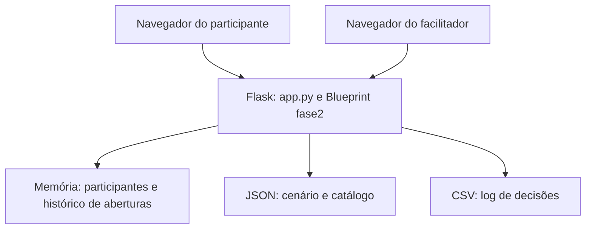

<!-- OBJETIVO: documentar os componentes, fluxos, limites e modos reais de implantação. -->
# Arquitetura

## Visão geral

Monólito web Python/Flask com templates Jinja e interface em HTML, CSS e JavaScript sem etapa de compilação de frontend. `app.py` cria a aplicação e registra a Fase 2 por `instalar_fase2(...)`, em `fase2.py`.

Os navegadores consultam APIs JSON por `fetch`. O servidor aplica as regras de pontuação e transição; as animações e a apresentação são controladas no cliente. Isso não impede manipulação de requisições, pois não existe autenticação.

## Componentes e responsabilidades

| Caminho relativo a `Simulação Web/` | Responsabilidade |
| --- | --- |
| `app.py` | Flask, Fase 1, estado compartilhado, lock, CSV e inicialização direta HTTP/HTTPS |
| `fase2.py` | Blueprint da investigação, sorteio, respostas, marcações, notas e controle de tentativas |
| `cenario.json` | Fases, tempos, ações, flags, objetivos e finais da Fase 1 |
| `interrogatorio.json` | Catálogo da investigação e perfis infectado/normal/pista |
| `templates/participante.html` | Estrutura da área de trabalho simulada |
| `templates/fase2.html` | Contêiner e inicialização do interrogatório |
| `templates/facilitador.html` | Painéis das duas fases e comandos de operação |
| `static/participante.js`, `static/fase1_ajustes.js` | Fluxo, consulta do estado, abertura e ajustes da Fase 1 |
| `static/interrogatorio.js` | Interface da investigação e caderno |
| `static/apoio_ui.js` | Áudio sintetizado e orientação |
| `static/controle_animacao.js`, `static/bloqueio_animacoes.js` | Coordenação de cenas, indicador e bloqueio de interação |
| `static/relatorio_final.js`, `static/encerramento.js` | Relatório visual e encerramento no navegador |
| `static/*.css` | Estilos das interfaces e das cenas |
| `dados/log_decisoes.csv` | Registro acumulado em disco |
| `Dockerfile`, `compose.yaml`, `.dockerignore` | Construção e execução em contêiner |
| `certs/`, `para_distribuir/`, `*.bat` | Apoio à implantação local Windows e certificados |

Os scripts dependem da ordem declarada nos templates. Na Fase 1, `apoio_ui.js` precede `participante.js` e `fase1_ajustes.js`; na Fase 2, precede `interrogatorio.js`, que é carregado antes da chamada a `iniciarInterrogatorio`. O template recebido carrega `encerramento.js` duas vezes; a revisão documental registra essa pendência, sem alterar o HTML.

## Estado e concorrência

`participantes` é um dicionário em memória, identificado pelo nome informado. Um `threading.Lock` é compartilhado entre as duas fases. O histórico de aberturas fica no dicionário `vistos`, fechado sobre a função de instalação da Fase 2.

Não há persistência transacional nem compartilhamento entre processos. O Gunicorn do Docker usa um worker e oito threads. Aumentar workers ou réplicas cria estados independentes e pode fazer participantes desaparecerem entre requisições. O [ADR 0001](adr/0001-estado-em-memoria.md) registra essa restrição.

O CSV é um registro parcial de eventos, não uma cópia do estado. O relatório final é montado no navegador; não existe serviço separado de relatórios nem persistência automática de seu conteúdo completo.

## Fluxo funcional

1. `POST /api/entrar` cria ou recupera o nome; o navegador guarda `tt_pid` em `localStorage`.
2. A interface exibe abertura/orientação e chama `/api/iniciar`; o servidor inicia os tempos.
3. `/api/estado/<pid>` consulta o estado e avalia tempo; `/api/executar` aplica decisões e também verifica tempo.
4. A Fase 1 termina ao atingir os três objetivos, em uma transição para `FIM`, por tempo total ou por encerramento do facilitador.
5. A página `/fase2` exige cookie de identificação, Fase 1 encerrada e ausência da ação “Formatar Máquina”. A API da Fase 2 usa o `pid` enviado no corpo e verifica o estado, sem autenticar o solicitante.
6. A primeira ação `estado` na API da Fase 2 cria o sorteio. A investigação usa token `tentativa` para evitar alterações de uma tentativa antiga.
7. A acusação encerra o caso, apresenta resultado e gabarito. O reinício permite novo sorteio após a conclusão.

Não há tarefa de segundo plano para avançar o relógio. A verificação de tempo ocorre nas requisições de estado/ação; o painel da Fase 1 não realiza essa verificação.

## Modos de implantação

| Modo | Entrada | Transporte | Particularidades |
| --- | --- | --- | --- |
| Python com certificados | `python app.py` | HTTPS/443 | Servidor de desenvolvimento Flask; tenta anunciar mDNS |
| Python sem certificados | `python app.py` | HTTP/5000 | Fallback; escuta em todas as interfaces |
| Docker recebido | `gunicorn ... app:app` | HTTP/5000 interno | Importa o módulo, sem executar o bloco `__main__`; não ativa TLS ou mDNS |

O Compose publica `127.0.0.1:5000:5000`: somente o host acessa por padrão. O Dockerfile copia explicitamente código, JSON, `static` e `templates`; não copia certificados nem o CSV recebido. O volume `tabletop_dados` monta `/app/dados`.

A dependência `gunicorn` está ausente em `requirements.txt`; seguir a [correção prévia do guia Docker](instrucoes_Docker.md). A arquitetura com proxy TLS/autenticação é uma possibilidade futura, não faz parte dos arquivos atuais.

## Configuração e limites

- `IP_SERVIDOR`, `NOME_HOST` e `PORTA_HTTPS` estão fixos em `app.py`; não há leitura dessas opções de variáveis de ambiente.
- O IP também aparece em `adicionar_hosts.bat` e `gerar_certificado.bat`.
- `cenario.json` é relido durante as chamadas que o utilizam; `interrogatorio.json` é lido ao instalar o Blueprint e exige reinício para recarga.
- Os hosts/IPs dos três suspeitos são conteúdo da simulação; o código não os consulta para investigar ou executar comandos.
- Não há integração automática com BitDefender, banco de dados ou recuperação de sessões.
- Não há capacidade simultânea homologada. Um ensaio com o público previsto é necessário.
